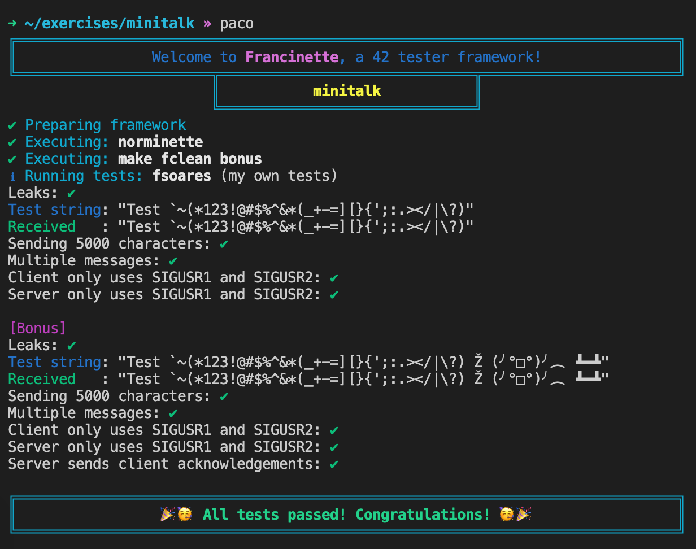

# Francinette — 2026 edition

An easy to use testing framework for the 42 projects, updated for the **2025/2026 subjects**.

Use `francinette` or `paco` inside a project folder to run it.

Tests: `libft`, `ft_printf` (v12.1), `get_next_line` (v14.3) and `push_swap` (v1.2).

> This is a fork of the original [Francinette](https://github.com/xicodomingues/francinette) by
> [xicodomingues](https://github.com/xicodomingues) (fsoares-), which is no longer maintained.
> All the credit for the framework goes to him and to the authors of the testers (see [Acknowledgments](#acknowledgments)).

## :exclamation: Write your own tests!

If you have little to no experience programming, write your own tests first. For example, for
`ft_split`, write a main that checks that your code works in most cases, and think about corner
cases: what should it return for `""`, `"   "` or `"word"`? Don't rely only on `francinette`.

### :warning: Francinette is not a replacement for your own tests, nor for the real moulinette. :warning:

## Table of Contents
1. [What's new](#whats-new)
2. [Purpose](#purpose)
3. [Install](#install)
4. [Update](#update)
5. [Running](#running)
6. [Uninstall](#uninstall)
7. [FAQ](#faq)
8. [Troubleshooting](#troubleshooting)
9. [Acknowledgments](#acknowledgments)

## What's new

Version **0.10.0** (see [`doc/CHANGELOG.md`](doc/CHANGELOG.md) for the full list).

#### :new: push_swap tester (subject v1.2)
- Detected automatically (Makefile with `NAME = push_swap`)
- Tests the strategies `--simple`, `--medium`, `--complex`, `--adaptive` and the `--bench` mode
- Disorder metric, error handling, parsing, already sorted inputs, small inputs, leaks
- Performance on 100 and 500 numbers
- Bonus: the `checker` program
- The operations are verified by a Python checker: **no `checker_linux` needed**

#### :new: Subject checks (ft_printf, get_next_line, push_swap)
Before the testers, francinette checks what the moulinette and the evaluators will look at:
- `README.md`: first line in italic, *Description* / *Instructions* / *Resources* sections
- `Makefile`: required rules, flags, relink, `clean` / `fclean` / `re`
- Allowed external functions and global variables (checked with `nm`)

Skip them with `francinette --ignore-subject` (or `-is`).

#### :new: get_next_line
- Compiles **without** `-D BUFFER_SIZE` (required by the subject)
- Tests with `BUFFER_SIZE=9999` and reading from a pipe
- `lseek` and the libft are detected as forbidden
- The "only one static variable" bonus check uses `nm`

#### :wrench: Fixes
- A failing fsoares test could crash the test program and show **"All tests passed"**. Crashes are now reported
- False memory leaks removed (4096 bytes in the fsoares tests, 36/56/2304... bytes in `printf --strict`)
- `printf --strict`: the "write fails → must return -1" check now works for every write, not only the first
- `printf`: address sanitizer + malloc mock crash on recent Linux
- `printf-unit-test`: missing includes with recent compilers
- Python 3.13 support (`pipes` module removed, invalid escape sequences)
- `NAME ?= ...` and comments are accepted in the Makefile

#### :scissors: Removed
The C Piscine, `minitalk` and `pipex` testers were removed, to keep only the projects that are maintained.

## Purpose

This is designed to work as a kind of `moulinette` that you can execute locally.

By executing `francinette` it will check `norminette`, check the subject rules, compile the code
and execute the tests.

#### Example execution:



## Install

Copy the line below to your terminal and execute it. It downloads the repo, creates the
necessary folders and aliases, and installs a Python virtual environment dedicated to this tool.

No admin rights needed: if the C compiler, `make` and `python3-venv` are already installed (like on
the 42 computers), nothing is installed with `sudo`. On your own Linux computer, if something is
missing and you are an admin, the installer installs it for you.

```
bash -c "$(curl -fsSL https://raw.githubusercontent.com/edar-42/francinette-2026/master/bin/install.sh)"
```

The francinette folder will be in your `$HOME` directory (`~/francinette`).

## Update

Francinette asks you when there is a new version. You can also force it:

```
~ $> francinette -u              # Forces francinette to update
```

If that does not work:

```
bash -c "$(curl -fsSL https://raw.githubusercontent.com/edar-42/francinette2026/master/bin/update.sh)"
```

> :warning: Updating does a `git reset --hard`: any local change you made in `~/francinette` will be lost.

## Running

At the root of a project, `francinette` finds which project it is and executes the corresponding tests.

You can also use the shorter command: `paco`. To see all the options: `paco -h`

```
/libft $> francinette                # Execute the tests for libft

/push_swap $> paco                   # Execute the tests for push_swap

/ft_printf $> paco --strict          # Stricter memory tests (malloc failing, exact allocations)

/get_next_line $> paco -b            # Only the bonus part

/push_swap $> paco -is               # Skip the subject checks (README, Makefile, functions...)

libft $> paco memset isalpha memcpy  # Executes only the specified tests

~ $> francinette -h                  # Shows the help message
```

The name of the folder is not important. What matters is that you have a `Makefile` with the name
of the project (for example `NAME = push_swap`) or the expected delivery files (for example `libft.a`).
Without them, `francinette` will not know which project to test.

```
~ $> francinette git@repo42.com/intra-uuid-234
```

This clones the git repository into the current folder and executes the corresponding tests.

All the files are copied to `~/francinette/temp/<project>`. This is where the norminette is
checked, the code compiled and the tests executed. If you run into unexpected problems, this is
where the magic happens.

Log files are in `~/francinette/logs`.

## Uninstall

Delete the `francinette` folder in your `$HOME` directory.

Then remove the aliases: open your `~/.zshrc` (or `~/.bashrc`) and delete these lines:

```
alias francinette="$HOME"/francinette/tester.sh
alias paco="$HOME"/francinette/tester.sh
```

## FAQ

#### This test is incorrect!

Please open an issue saying which project and which test fails, and why you think it is wrong.
You can also fix it and open a pull request!

#### The subject checks say my README is wrong

The 2025/2026 subjects require a `README.md` with the first line in italic and the sections
*Description*, *Instructions* and *Resources* (and more for push_swap: algorithms, contributions of
both learners...). If you just want to run the tests, use `paco -is`.

#### What is NULL_CHECK in strict?

It makes every call to `malloc` fail and return `NULL`, to check that you protect your allocations
and don't get segmentation faults.

#### The get_next_line tester gives me Timeout errors

The tester gets slower with every `malloc` you do, so with a lot of mallocs it can timeout.
In strict mode this is very common, don't worry too much about it.

#### How do I add a tester for another project?

Create a `ProjectTester.py` file in `testers/` and add it to the `PROJECTS` list in `main.py`.

## Troubleshooting

#### `command not found: francinette`

The installer adds two aliases, `francinette` and `paco`, to `~/.zshrc` (or `~/.bashrc` on Linux).
If you use another shell, add them yourself:

```
alias francinette="$HOME"/francinette/tester.sh
alias paco="$HOME"/francinette/tester.sh
```

Then open a new terminal.

## Acknowledgments

* To [xicodomingues](https://github.com/xicodomingues) (fsoares-) for creating [Francinette](https://github.com/xicodomingues/francinette)
* To 42 for the projects
* To [Tripouille](https://github.com/Tripouille) for [libftTester](https://github.com/Tripouille/libftTester), [gnlTester](https://github.com/Tripouille/gnlTester) and [printfTester](https://github.com/Tripouille/printfTester)
* To [jtoty](https://github.com/jtoty) and [y3ll0w42](https://github.com/y3ll0w42) for [libft-war-machine](https://github.com/y3ll0w42/libft-war-machine)
* To [alelievr](https://github.com/alelievr) for [libft-unit-test](https://github.com/alelievr/libft-unit-test) and [printf-unit-test](https://github.com/alelievr/printf-unit-test)
* To [cacharle](https://github.com/cacharle) for [ft_printf_test](https://github.com/cacharle/ft_printf_test)
* To [ombhd](https://github.com/ombhd) for [Cleaner_42](https://github.com/ombhd/Cleaner_42)
